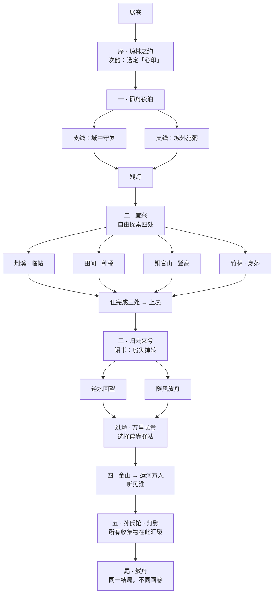

# 《行舟入墨》流程设计：衔接 · 分支 · 汇聚

> 依据：《重构方案》（主题与诗文）、《玩法库》（17 种玩法）。
> 展厅约束、游客版/评审版时长、画卷展示方式以《展厅与架构》为准；本文描述的是完整版流程。
>
> 本文回答三个问题：
> 1. 玩法和玩法之间、幕和幕之间**怎么衔接、怎么转场**，才能一气呵成？
> 2. 整体有**哪些分支**？
> 3. 分支**怎么汇聚到同一个结局**？

---

## 一、总体结构："一卷多径"

整体是**一幅长卷**：开头展开，结尾卷起。中间有多条路，但所有路最后都画在同一幅卷上。



**设计原则**：

- **分支只改变"怎么走"和"画里有什么"，不改变史实。** 苏轼买田、上表、被起用、北归、病逝，这些不能变。玩家能选的是：看什么、做什么、以什么心境经历它。
- **分支有宽有窄**：小选择在幕内（选哪个意象、先去哪里），大分叉在中段（掉头之后怎么面对、远游停在哪里）。
- **没有死路，没有失败**：每条路都能走完，最短路线约 15 分钟，完整路线约 30 分钟。

---

## 二、转场语法：七种转场，各有用途

全篇只用七种转场，每一种都来自纸、墨、印、卷，并且固定用在特定场合。玩家看多了会形成直觉：看到某种转场，就知道接下来发生什么。

| # | 转场 | 画面 | 用在 | 含义 |
|---|---|---|---|---|
| T1 | **展卷 / 收卷** | 卷轴从中间向两侧展开或合拢 | 开场、结尾 | 一个完整故事的开始与结束 |
| T2 | **墨滴入水** | 一滴墨从点击处落下，晕开盖满屏幕 | 从探索进入一段演出 | 进入 |
| T3 | **印化为景** | 一幕结尾盖下的朱印，变成下一幕的一个景物（太阳、火光、灯） | 幕与幕之间 | 时间跨越，但情感延续 |
| T4 | **物件接力** | 同一件物品（或同样形状）跨越两个画面，镜头不切 | 幕内段落之间、幕与幕之间 | 两件事有联系 |
| T5 | **字化为景** | 诗句或帖上的字笔画散开，重组成景物 | 诗成之后进入下一段 | 诗即画 |
| T6 | **拂雾** | 淡墨雾气盖住画面，玩家擦开 | 时间跨度较大时 | 往事浮现 |
| T7 | **硬切** | 无任何过渡，瞬间换画面，声音也同时切断 | **全篇只用一次**：第四幕 → 第五幕 | 断裂（从万人喧哗到病榻寂静） |

> T3 是全篇最重要的转场：**每一幕都以盖印收尾，印又变成下一幕的开头**，形成一条没有断点的链条。

---

## 三、每一幕内部的节拍："五拍"

每一幕都按同样的五拍组织，玩家熟悉节奏后，不用说明也知道自己在哪一步：

```
① 入画      ② 主玩法      ③ 诗成        ④ 钤印       ⑤ 化印
三远构图  →  本幕核心   →  意象齐备，  →  刻印、盖印  →  印变成下一幕
把画构出来    玩法          诗句写出                     的一个景物
（10-20 秒）  （2-4 分钟）  （10 秒）      （10-15 秒）  （3-5 秒，即转场 T3）
```

- **① 入画**用三远构图（玩法 12）：每幕开场画面是散开的几层，玩家拖动拼好构图后进入。高远、深远、平远轮流使用，对应不同场景。熟练玩家可以一键自动构图。
- **③ 诗成**的诗句来自 ② 中玩家的行为，所以每个人看到的诗句出现顺序、画面细节略有不同。
- **④ 钤印**的印文每幕不同，印本身就是收集物，最后汇入结局。

---

## 四、逐幕流程与衔接

下面每幕列出：**进入方式 → 幕内流程 → 分支 → 收集物 → 离开方式**。

### 开场 · 展卷

- 竖排标题"行舟入墨"，朱印按钮"展卷"。
- **T1 展卷**：卷轴展开，画面上是一片空白宣纸，只有远处一点淡墨。镜头推进这点墨，墨晕开成汴京城的轮廓。

---

### 序 · 琼林之约（1057，汴京）

**幕内流程**

1. **入画（高远）**：拖动城墙、宫阙、灯火三层，构成汴京夜景。
2. 镜头沿御街飞入琼林苑。宴席上，蒋之奇讲起家乡阳羡的山水。
3. **主玩法：次韵（玩法 6）**。蒋之奇身后展开一幅阳羡画轴，画上有三处留白。玩家为每处留白从三个意象中选一个（山 / 水 / 竹），选中的意象画进去。
4. **诗成**："琼林花草闻前语，罨画溪山指后期"题在画轴一角。
5. **钤印**：印文"约"。

**分支：心印**
三次选择中选得最多的意象，成为玩家的 **「心印」**：

| 心印 | 含义 | 后续影响 |
|---|---|---|
| 山 | 向往高远 | 第二幕铜官山登高时多一段云海；结局画卷以山为主体 |
| 水 | 向往闲适 | 第二幕荆溪临帖时多一段泛舟；结局画卷以水为主体 |
| 竹 | 向往清节 | 第二幕竹林烹茶时解锁"一笔画竹"；结局画卷以竹为主体 |

**离开（T4 物件接力 + T3 印化为景）**
画轴卷起，变成一支细长的卷轴横在画面中央；镜头拉远，卷轴变成一条黑色的河：常州城外的运河。朱印"约"落在远处，变成**城头一点守岁的火光**。

---

### 第一幕 · 孤舟夜泊（1073 除夕，常州城外）

**幕内流程**

1. **入画（平远）**：拖动城墙、运河、近岸三层。
2. 小船泊在岸边，舱中一盏残灯。夜风阵阵，玩家按住遮挡护灯（玩法 5 意象成景的辅助操作）。
3. **主玩法：意象成景（玩法 5）+ 墨分五色（玩法 1）**。画面中藏着七个意象：行歌、野哭、远火、低星、重衾、新沐、残灯。远火、低星需要玩家蘸淡墨、清墨亲手点出来。
4. 每找到一个意象，听到一句吟诵。

**分支：行歌 / 野哭**
诗的第一句"行歌野哭两堪悲"有两个方向，玩家先走向哪一边，这一幕的中段就不同：

| 支线 | 内容 | 收集物 |
|---|---|---|
| A · 城中守岁（行歌） | 镜头进入城中，家家守岁、爆竹声声，苏轼隔着城墙听着，更觉孤独 | 一枚爆竹残纸 |
| B · 城外施粥（野哭） | 镜头来到城外饥民的篝火旁。玩家把船上的米分给饥民（拖动米袋到各个火堆） | 一只粥碗 |

两条支线结束后都回到船上，残灯仍亮着。走了一条，另一条可以在回看时补上。

> 支线 B 埋了一个伏笔：十一年后苏轼上《乞常州居住表》，里面写"臣有薄田在常州宜兴县，粗给饘粥"。碗在第二幕上表时会再次出现。

5. **诗成**：全首写在夜空中。
6. **钤印**：印文"残灯"。

**离开（T3 + T6 拂雾）**
天将破晓，残灯燃尽。朱印"残灯"化为**东方升起的红日**。浓雾升起盖满画面，雾上浮现"十一年后"。玩家擦开雾气，船已驶入荆溪。

---

### 第二幕 · 宜兴（1084）——开放区域

这一幕是全篇唯一的**开放区域**，节奏最自由。

**幕内流程**

1. **入画（平远，俯瞰）**：拖动太湖、群山、荆溪、田野四层，构成太湖西岸全景。
2. **字化为景（T5）**：《楚颂帖》首句"吾来阳羡，船入荆溪，意思豁然"写在水面上，然后字迹散开，变成两岸的竹林、田垄、山峦。
3. 进入**俯瞰地图**，四处地点用淡墨标出，玩家自由选择去哪里，顺序不限：

| 地点 | 玩法 | 诗文 | 收集物 | 心印加成 |
|---|---|---|---|---|
| 荆溪岸 | 临帖（玩法 3）：描《楚颂帖》，"橘"字长成橘树 | 《楚颂帖》 | 帖上一字 | 水：加一段泛舟 |
| 田间 | 营园种橘（玩法 9）：选地、种橘、建楚颂亭、转季节 | 《楚颂帖》"种柑橘三百本" | 一枚橘 | — |
| 铜官山 | 立轴登高（玩法 13）：竖向攀登，云散见太湖 | 《菩萨蛮》+ 吟诵节奏（玩法 7） | 一片云 | 山：加一段云海 |
| 竹林茶寮 | 烹茶（玩法 10）：汲泉、候汤、点茶，茶沫上分茶作画 | "从来佳茗似佳人" | 一盏茶 | 竹：解锁一笔画竹 |

**四处之间如何衔接**：
- 每处完成后，地图上该处由淡墨变浓墨，并且**这一处的成果会出现在别处**：种下的橘树在登山时能从山顶看到；临帖写的字会挂在茶寮墙上。玩家能感觉到这些地方是同一个世界。
- 地点之间不用菜单跳转，而是镜头在俯瞰图上**平移推近**（T4 的变体），始终在同一幅画里。

4. **汇合条件**：完成任意三处，田边出现一头牛，触发"卖剑买牛吾欲老"，然后进入上表。第四处可以继续做，也可以留到回看。
5. **上表（沿用 v3）**：向下划动落笔写《乞常州居住表》，再向右划动呈上。若在第一幕走过支线 B，**那只粥碗会出现在案头**，写到"粗给饘粥"时轻轻一亮。
6. **诗成**：《菩萨蛮》全首。
7. **钤印**：印文"一虚舟"（取自《菩萨蛮》"来往一虚舟"）。

**离开（T4 物件接力）**
表文向右飞出画面。片刻后，**同一卷表文从左边飞回**，已经变成朱批的诏书：朝廷准了。直接进入第三幕。

---

### 第三幕 · 归去来兮（1085）

**幕内流程**

1. **入画（深远）**：麦田、山寺、远山三层。
2. **上半段：吟诵节奏（玩法 7）**。苏轼乘船回宜兴，玩家跟着《归宜兴留题竹西寺》的吟诵按键：平声长按画出麦浪、远山，仄声短按落下野花、飞鸟。画面越来越丰美。
3. **转折**：第二卷诏书从天而降：朝廷起用他。船头被强行掉转（沿用重构方案中"输入失效"的设计）。

**分支：逆水回望 / 随风放舟**
船头掉转后，玩家的反应决定这段的走向：

| 支线 | 触发 | 画面 | 诗文 | 心境 |
|---|---|---|---|---|
| A · 逆水回望 | 玩家继续往回划 | 船仍然后退，但镜头始终对着宜兴，橘园、楚颂亭越来越小，最后成为地平线上一个墨点 | 《满庭芳》"老去君恩未报，空回首、弹铗悲歌" | **思归** |
| B · 随风放舟 | 玩家停手，或顺着船的方向划 | 镜头转向前方，长风满帆，江面开阔 | 《满庭芳》"船头转，长风万里，归马驻平坡" | **旷达** |

两条支线同样长，不分好坏。玩家可以中途改变主意，以最后五秒的状态为准。

4. **钤印**：印文"归去来"。

**离开（T4 物件接力）**
第二卷诏书展开、再展开，越来越长，**变成万里长卷**，镜头拉远进入过场。

---

> **现行实现**：以下"过场"到"尾声"四段已合并为终幕「肆 · 舣舟」（`ashore`）：万里长卷（停靠驿站）→ 海浪变江浪、金山立起 → 对镜《自题金山画像》→ 推进画像的眼睛入运河、听人群 →"莫看杀轼否？"→ 钤「不系舟」→ T7 → 孙氏馆移灯成"舣"→《答径山琳长老》→ 放手 → "舣舟"印落下 → 化为舣舟亭中灯。暂缺：金山立轴登高、千人画卷的自由推拉、孙氏馆烹茶、时光轮盘与漫游、个人长卷。

### 过场 · 万里长卷（1085—1101）

**流程**
苏轼此后十六年的路线用墨线在长卷上画出：汴京 → 杭州 → 颍州 → 扬州 → 定州 → 惠州 → 儋州。墨线自动前进，不需要操作。

**分支：停靠驿站**
墨线经过三处时会**放慢**，并出现一点朱红。玩家点击就停下来，进入一段 20—30 秒的小画面；不点击就继续前进。最多可停两处：

| 驿站 | 小画面 | 收集物 |
|---|---|---|
| 杭州 | 苏堤春晓，柳色如烟 | 一枝柳 |
| 惠州 | 罗浮山下，荔枝满树（"日啖荔枝三百颗"） | 一颗荔枝 |
| 儋州 | 海天一线，茅屋读书 | 一枚贝壳 |

儋州无论停不停都会经过：海浪拍满屏幕，然后船掉头向北。

**离开（T4 物件接力）**
儋州的海浪变成长江的浪，浪中立起金山。

---

### 第四幕 · 不系之舟（1101 夏）

**幕内流程**

1. **入画（高远）**：长江、金山、寺塔三层。
2. **立轴登高（玩法 13）**：画面变成竖幅，玩家沿金山石阶向上走，到寺中李公麟所画的苏轼像前。
3. **对镜**：玩家横向拖动，在"画中的苏轼"和"画前的苏轼"之间推移，两张脸重叠时，《自题金山画像》四句落下。"黄州惠州儋州"三个地名依次出现，**如果过场停靠过某个驿站，对应的收集物会在这里一闪**。
4. **物件接力进入运河**：镜头推进画像的眼睛，眼中倒映出一条河，镜头穿过倒影，来到常州段运河上空。
5. **主玩法：千人画卷（玩法 16）**。镜头俯冲到两岸人海。玩家自由推拉镜头，靠近不同的人群能听到他们的话。

**分支：听见谁**
人海中有五类人，每类说的话不同。玩家听到任意三类后，触发"莫看杀轼否？"：

| 人群 | 他们说的话（示意） | 关联前文 |
|---|---|---|
| 书生 | 背诵苏轼的诗 | 如果心印是竹，他们背"宁可食无肉" |
| 农人 | 说起宜兴的橘子 | 第二幕种过橘才出现 |
| 老人 | 回忆当年除夕城外有人施粥 | 第一幕走过支线 B 才出现 |
| 孩童 | 追着船跑，问"哪个是东坡" | 总是出现 |
| 僧人 | 提到金山、径山 | 为第五幕维琳出场铺垫 |

> 这里是前面分支的第一次"回响"：玩家会在人群中听到自己做过的事。

6. **台词**："莫看杀轼否？"全场人声骤停一拍。
7. **钤印**：印文"不系舟"。

**离开（T7 硬切，全篇唯一一次）**
印刚落下，**声音和画面同时切断**：下一帧就是孙氏馆漆黑的屋子，只有一盏灯。

---

### 第五幕 · 着力即差（1101 七月，孙氏馆）——汇聚点

这是所有分支**汇聚**的地方。

**幕内流程**

1. **入画（深远）**：窗、藤、河三层，窗外月光。这一幕的入画是自动完成的，玩家只需要看。
2. 友人到访。若第二幕去过竹林茶寮，这里有一段烹茶（玩法 10），为友人煮一盏茶。
3. **主玩法：灯影成字（玩法 15）**。
   - 桌上摆着玩家一路收集的物品：爆竹纸或粥碗、橘、帖字、云、茶、柳或荔枝或贝壳……**每个玩家桌上的东西都不一样。**
   - 玩家移动灯的位置，让这些物品的影子投在窗纸上。
   - **无论桌上是什么，影子最后都会拼成同一个字："舣"。**（实现上，影子形状由程序根据物品组合计算，保证总能拼出这个字；物品越多，字越饱满，但少也能成字。）
4. 《答径山琳长老》"大患缘有身，无身则无疾"写在窗纸上，随月光淡去。
5. **放手**：窗外河上的小船，缆绳由玩家按住。钱世雄劝他用力想想来世，苏轼答："着力即差。"玩家松手，船轻轻靠岸。
6. 灯灭。
7. **钤印**：没有刻印的步骤。黑暗中，一方朱印自己落下：**"舣舟"**。

**汇聚的含义**：不同的人走过不同的路、带着不同的东西，最后的影子都是同一个字。这正是苏轼的一生：漂泊的路线各不相同，最终都在常州靠岸。

**离开（T3 印化为景）**
黑暗中的朱印"舣舟"慢慢变亮、变暖，化成**舣舟亭里的一盏灯**。

---

### 尾声 · 舣舟（后世—今）

**流程**

1. **时光轮盘（玩法 17）**：固定机位，舣舟亭从宋到今。玩家转动轮盘，看亭子毁了又修，乾隆南巡船队经过，最后是今天的东坡公园。画面第一次出现柔和的设色。
2. **自由漫游**：回到 v3 式的横向长卷。前面的收集物会出现在公园里对应的位置（橘树、竹林、茶亭……），点击可以回看那一段。
3. **卷起长卷（T1 收卷）**：玩家准备好后，画面开始向两侧收拢。收卷前，整幅长卷展开给玩家看一遍。

---

## 五、同一结局，不同画卷

结局只有一个：**舣舟亭，朱印"舣舟"，一句话"他漂泊了一生，最后在这里靠了岸"。**
但每个玩家最后看到的那幅长卷是自己的：

| 画卷中的部分 | 来自哪里 | 变化 |
|---|---|---|
| 画卷的主体 | 序幕「心印」 | 山、水或竹为主 |
| 七方印章 | 每幕钤印 | 位置固定，印色深浅取决于盖印时的力度 |
| 卷首小景 | 第一幕支线 | 城中灯火 或 城外篝火 |
| 中段园林 | 第二幕完成的地点 | 三处或四处，完成的才画出来 |
| 一段题跋 | 第三幕心境 | 思归："空回首、弹铗悲歌"；旷达："长风万里，归马驻平坡" |
| 远游的点缀 | 过场驿站 | 柳、荔枝、贝壳，或都没有 |
| 岸上人群 | 第四幕听到的人 | 听过的人群画在岸上 |
| 卷尾 | 所有路线相同 | 舣舟亭 + "舣舟"印 |

收卷后可以选择：

- **再泛一次**：从头开始，提示"换一种心印试试"。
- **回看**：从章节列表进入任一幕，补上没走的支线。
- **留存画卷**：把自己的长卷保存下来（可以做成长图导出，或作为终章「纸上常州」的一块拼图）。

---

## 六、状态记录

整个流程只需要记录少量状态，便于实现和调试：

```js
const journey = {
  heart: 'mountain' | 'water' | 'bamboo',     // 序：心印
  night: 'song' | 'porridge',                   // 一：行歌 / 野哭（先走的那条）
  yixing: ['stele', 'orchard', 'peak', 'tea'],  // 二：完成了哪几处（至少 3 处）
  mood: 'longing' | 'free',                     // 三：思归 / 旷达
  stops: ['hangzhou', 'huizhou', 'danzhou'],    // 过场：停靠的驿站（0—2 处）
  heard: ['scholar', 'farmer', 'elder', 'child', 'monk'], // 四：听到的人群（至少 3 类）
  items: [],                                    // 收集物，第五幕灯影使用
  seals: [],                                    // 七方印及其印色深浅
};
```

- 每个分支只**写入**状态，后续场景只**读取**状态来决定"多出现一点什么"，不会因为状态缺失而卡住。
- 调试入口：`#act=<段落id>` 直接跳段，并可用 `&heart=bamboo&mood=free` 之类的参数预设状态（段落 id 见《展厅与架构》第四节）。

---

## 七、节奏总览

| 段落 | 最短 | 完整 | 情绪 | 主转场 |
|---|---|---|---|---|
| 展卷 + 序 | 2 分钟 | 3 分钟 | 意气 | T1 → T4 |
| 一 · 夜泊 | 3 分钟 | 5 分钟 | 孤寒 | T3 + T6 |
| 二 · 宜兴 | 4 分钟 | 8 分钟 | 豁然 | T5、T4 |
| 三 · 归去来兮 | 2 分钟 | 3 分钟 | 欢喜 → 怅然 | T4 |
| 过场 | 1 分钟 | 2 分钟 | 漂泊 | T4 |
| 四 · 不系之舟 | 3 分钟 | 5 分钟 | 壮阔 | **T7** |
| 五 · 着力即差 | 2 分钟 | 3 分钟 | 释然 | T3 |
| 尾 · 舣舟 | 1 分钟 | 3 分钟 | 绵长 | T1 |
| **合计** | **约 18 分钟** | **约 32 分钟** | | |

**设计要点**：

- 第二幕（最自由、最长）之后紧接第三幕（最短、被迫），自由和身不由己形成反差。
- 第四幕（最喧闹）之后硬切第五幕（最安静），全篇情绪落差最大的地方，也是全篇唯一的硬切。
- "跳过"默认只跳过演出，遇到选择点仍会停下让玩家选；如果玩家连选择点也跳过，分支取默认值（心印"水"、支线 A、心境"旷达"、不停靠驿站），保证状态完整。
