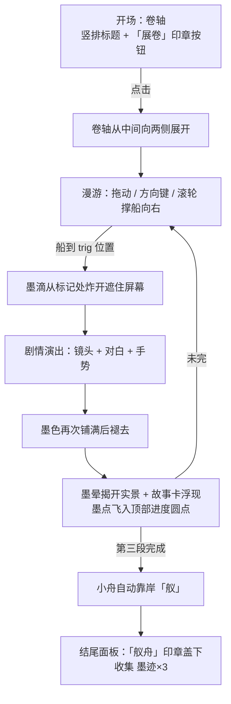

# 《行舟入墨》设计分析：思想 · 流程 · 风格

> **早期稿**：这是对 v3 原型的分析，不是新版设计。新版见《流程设计》《展厅与架构》。
>
> 分析对象：`prototypes/scene-01-sushi-v3.html`（古代篇 · 墨染成景 · 苏轼 × 舣舟亭）
> 用途：总结这一章的创作思路，后续章节（如「经纬织城」、终章「纸上常州」）可以照着做，保持同一套语言。

---

## 一、核心思想

### 1. 一句话概括

**用一叶小舟顺着运河走过苏轼和常州的三段因缘；每到一处，墨就晕开，把这处景"画"出来。**

标题"行舟入墨"有两层意思：

- **行舟**：玩家的动作就是撑船往前走，时间线也跟着往前走（1084 → 1101 → 后世）。
- **入墨**：每一段故事都以"墨色晕染"开场、以"墨色晕染"收尾，景物原本只是淡淡的影子，看完故事才被墨"点亮"。

### 2. 四个设计原则

| 原则 | 在作品中的体现 |
|---|---|
| **空间即时间** | 横向长卷（4400 宽）就是时间轴。三个节点 `SCENES_X = [1300, 2460, 3720]` 依次对应择居、北归、筑亭，往右划就是往后走。 |
| **先见影，后见形** | 节点处的景物开始只是 7.5% 透明度、模糊过的"鬼影"（`n.ghost`），故事演完后才用墨晕遮罩（`mInk`）把实景揭开。看完故事，景才属于你。 |
| **亲手参与关键的一刻** | 关键情节不是放给你看，而是让你用手势完成：落笔写表、呈上表文、摇橹三次、筑起亭子。划动的进度直接驱动画面。 |
| **史实克制，诚实标注** | 每句引文都标出处（《菩萨蛮》《乞常州居住表》《邵氏闻见后录》）；亭子明确注明"为后世纪念建筑，并非苏轼当年所见"；页脚常驻"画面与演出为艺术化表现，非历史场景复原"。艺术化处理，但不冒充史实。 |

### 3. 情感弧线

```
择居（向往）   →   北归（高潮/告别）   →   筑亭（追念）
"吾将老"            "千万人随观之"          "后人筑亭"
 明亮、日在中天      人潮、主角渐隐成影       暮色、红日西沉、影子回望
```

第二段的处理最用心：岸上人群一层层浮现，然后切到苏轼特写，说完"莫看杀轼否？"，人物慢慢褪成半透明的虚影（`opacity .22 + fGhost`），旁白再交代"同年七月，苏轼在常州病逝"。死亡没有直接画出来，用"淡去"来表达。第三段的鬼影苏轼远远站在亭边（`opacity .32`），和这里前后呼应。

---

## 二、体验流程

### 1. 总流程



### 2. 状态机

代码里用 `state` 一个变量管住全局：

```
intro → play ⇄ cut → … → moor → end
```

- `play`：玩家可以控制船。
- `cut`：剧情接管，船速逐渐衰减（`boatV *= .8`）。
- `moor`：最后一段结束后，船自己慢慢漂到终点 `MAXX`，这一步把"舣"（使船靠岸）演了出来，不只是文字解释。
- `end`：弹出结尾面板。

### 3. 单段剧情的结构

每段剧情都是一个 `async` 函数，按 `shot → say → gesture → say …` 线性往下写，读起来像分镜脚本：

| 段落 | 镜头 | 手势交互 | 结果 |
|---|---|---|---|
| 壹 · 买田阳羡 | 柳岸 + 苏轼立像 + 表文卷 | ↓ 落笔（三列字依次写出，笔跟着走）<br/>→ 呈上（表文旋转、缩小、飞走） | 准奏，却又被起用离开 |
| 贰 · 夹岸相看 | 运河 + 远处市镇 + 船 | ← → 摇橹 ×3，每划一次船往前一段，岸上人群多一层 | 切特写 → 名句 → 人物淡去 |
| 叁 · 舣舟筑亭 | 暮色、红日、柳、松 | ↓ 筑亭（墨流从天而降：台基 → 立柱 → 栏杆 → 屋顶落下 → 宝顶 → 匾额） | 朱印「舣舟亭」+ 虚影苏轼 |

### 4. 交互细节

- **漫游输入三选一**：拖动（船追着指针）、方向键/AD、滚轮（带衰减的冲量）。点水面会起涟漪，船尾自动留水纹，前方偶尔有鱼跃出。这些都是"不催你但值得玩"的小东西。
- **手势是"有阻力的滑杆"**：松手后进度会以 0.025/30ms 回弹，必须"缓慢划动"到底才算完成，有仪式感；同时也支持方向键和滚轮，不强制只能用鼠标。
- **对白两段式推进**：第一次点击直接显示全文，第二次进入下一句；`▼` 闪烁提示可以继续。
- **随时可跳过**：`跳过 ››` 设 `Cut.skip = true`，之后所有 `sleep` 都变成 0，`say`/`gesture` 立即完成，演出流程不需要为跳过单独写分支。
- **调试入口**：URL 加 `#ep1`~`#ep3` 可以直接跳到对应剧情前面。

---

## 三、视觉风格

### 1. 基调：宋人水墨长卷 + 白描人物

- **纸**：米黄底色 `--paper:#efe7d6`，canvas 生成的纸纹叠在最上层（`mix-blend-mode:multiply`），四周加暖色暗角。
- **墨**：几乎所有颜色都由 `ink(a) = rgba(28,27,25,a)` 一个函数生成，靠透明度区分浓淡干湿。整幅画就一种墨色，分出很多层次。
- **朱**：唯一的强调色是印泥红 `--seal:#b03a2e`，只用在印章、标记、手势箭头、绦带、太阳上。看到红色，就是该注意或该操作的地方。
- **点缀**：靛青 `INDIGO`（衣缘）、金 `--gold`（剧情标题序号）、暮色渐变 `gDusk`（只在第三段出现）。

### 2. 用 SVG 滤镜模拟笔墨

| 滤镜 | 作用 |
|---|---|
| `fWash` | 大尺度扭曲 + 强模糊 → 远山的**渲染**效果 |
| `fInkEdge` | 中尺度扭曲 → 中景山的**墨边** |
| `fBleed` | 高频小扭曲 → 岸线、桥、芦苇的**洇墨毛边** |
| `fRipple` | 横向拉长的扭曲 → **水中倒影** |
| `fBlob` / `fBloom` | 超大扭曲 → 转场墨团、景物揭开时的**墨晕** |
| `fGhost` / `fDof` | 纯模糊 → 未解锁的**虚影**、前景人物的**景深** |

### 3. 程序化"笔触"

画面里的景物都是代码一笔笔生成的，没有用图片：

- `taper()`：沿中心线生成两头粗细不同的笔画，模拟毛笔的**起笔和收笔**（柳干、柳丝、松枝都用它）。
- `ridge()`：用高斯峰叠加多频噪声生成山脊。
- `willow()`：后层淡墨柳丝 → 树干 → 枝 → 前层浓墨柳丝，**先淡后浓**，和水墨的作画顺序一致。
- `pine()`：树干浅墨填色、浓墨勾边，加鳞皴，针叶扇形排开。
- 远树用**米点**（椭圆点叶），山头加**苔点**，岸边加**枯笔**横扫。
- 固定随机种子 `sd = 20261023`，所以每次打开画面完全一样，但看起来是手绘的。

### 4. 空间层次

五层视差：`far .18 / mid .45 / main 1 / fx 1 / front 1.35`。远山几乎不动，前景芦苇比船还快，长卷就有了纵深。北岸（远）—水面—南岸（近）三段式构图，和传统手卷"平远"的看法一样。

### 5. 人物

- 苏轼：白描勾线 + 淡设色，东坡巾、长须、大袖、朱红绦带。身体压低加宽、头部放大，接近人物画比例而不是写实比例。
- 艄公：斗笠蓑衣，剪影化处理，作为配角不抢戏。
- 人群：极简剪影，几种头饰（髻、幞头、斗笠）随机组合，靠数量和层次营造"千万人"。
- 静止镜头里人物有极轻微的"呼吸"缩放（`breath`，1% 以内），画面不会显得死板。

### 6. 字与版式

- 书法字体 `Ma Shan Zheng`（马善政楷书）用于标题、人名、印章；正文用 `Noto Serif SC` 宋体。
- 开场标题、表文、题字、结尾印章**竖排**；HUD、故事卡用横排，保证易读。
- 中文数字序号 **壹 / 贰 / 叁** 刻在朱印里，贯穿进度、故事卡、剧情标题三处。
- 题跋式文字：第三景右上角大字"舣舟"+小字"後人築亭"+朱印"常"，就像画上的题款和钤印。

### 7. 动效语言

全片只有几种动作，而且都和"纸、墨、卷"有关：

| 动效 | 隐喻 |
|---|---|
| 开场 `clip-path` 从中间向两侧打开，两侧有木轴 | **展卷** |
| 转场：墨团从点击处旋转放大，盖满全屏 | **墨滴入水** |
| 景物揭开：多个圆形遮罩带噪声扩散 | **墨在宣纸上洇开** |
| 墨点从画面飞进顶部进度圆圈 | **收集墨迹** |
| 结尾印章从 2.2 倍带弹性"砸"下来 | **钤印** |
| 故事卡从模糊到清晰（`filter: blur`） | **字迹显现** |

缓动多用 `easeOut` 和 `cubic-bezier(.55,0,.35,1)`，先快后慢，比较沉稳，没有轻佻的弹跳（只有盖章这一处故意用了回弹）。

---

## 四、叙事与文案风格

- **旁白克制、短句、交代事实**："元丰八年（1085 年），朝廷准其所请。""可没过多久，他又被朝廷起用，离开了常州。"不抒情，留白给画面。
- **人物只说原文**：苏轼的台词全部是他本人的诗文或史料记载的原话，并在下方小字注明出处和白话释义。
- **年份双写**：年号 + 公元年，照顾不同读者。
- **生僻字注音**："舣"（yǐ）。
- **操作提示与情节合一**："向下缓慢划动 · 落笔""左右划动 · 摇橹（1/3）"，告诉你怎么操作，同时也告诉你这个动作在故事里是什么。
- **免责声明分层**：全局页脚 → 故事卡注 → 剧情对白注，三处各说一次，不打断沉浸感，但不让人误解。

---

## 五、工程风格

- **单文件、零依赖**：一个 HTML 包含所有样式、SVG、脚本，只外链了 Google Fonts，打开就能看。
- **全部程序化生成**：没有一张位图素材，整个文件约 80KB。
- **素材复用**：人物、小舟都定义成 `<symbol>` / `<g>`，世界和剧情共用（`#boatArt`、`#sym-sushi`），倒影直接 `use` 加翻转。
- **数据驱动节点**：`NODES` 数组定义位置、触发点、印章、标题、正文、注释；`EPISODES` 数组对应演出函数。加一段故事只需加一项数据加一个 `ep` 函数。
- **演出 = 可 await 的原语**：`shot()`、`say()`、`gesture()`、`sleep()` 都返回 Promise，剧情脚本是线性的 `async` 代码，跳过逻辑统一收在 `Cut.skip` / `Cut.cancel` 里。
- **健壮性兜底**：`tick()` 在 rAF 被暂停时（后台标签页、隐藏 iframe）用 `setTimeout` 补上；`resize()` 防止视口为 0 导致 NaN。
- **移动端适配**：640px 以下故事卡移到底部、缩小字号、隐藏页脚；`touch-action:none` + Pointer Events 统一处理鼠标和触摸。

---

## 六、后续章节可复用的模板

做新的一章时，可以照这个清单逐项对照：

1. **一个贯穿动作**：本章是"行舟"。新章节也要找一个和主题相关的移动方式（如"经纬织城"可以是"穿梭/引线"）。
2. **三个节点 = 三幕**：起（选择/到来）→ 承转（高潮）→ 合（后世纪念），每幕一个手势。
3. **先影后形**：节点景物先以虚影出现，演完再用墨晕揭开。
4. **手势即情节**：每个手势对应故事里一个具体动作，提示语写成"操作 · 动作名"。
5. **只引原文，必注出处**：台词用史料原话，后世建筑、艺术化人物都要加注。
6. **配色纪律**：墨色分浓淡 + 一点朱红，其他颜色只在某一幕作为情绪点缀。
7. **统一的收集物**：每段结束收集一枚"墨迹"，进入顶部进度，章末汇总到终章「纸上常州」。
8. **章末钤印**：一枚和本章主题相关的印（本章"舣舟"），加"再来一次"和"下一章"两个按钮。
9. **保留调试入口**：`#epN` 直接跳段，方便打磨单段演出。
